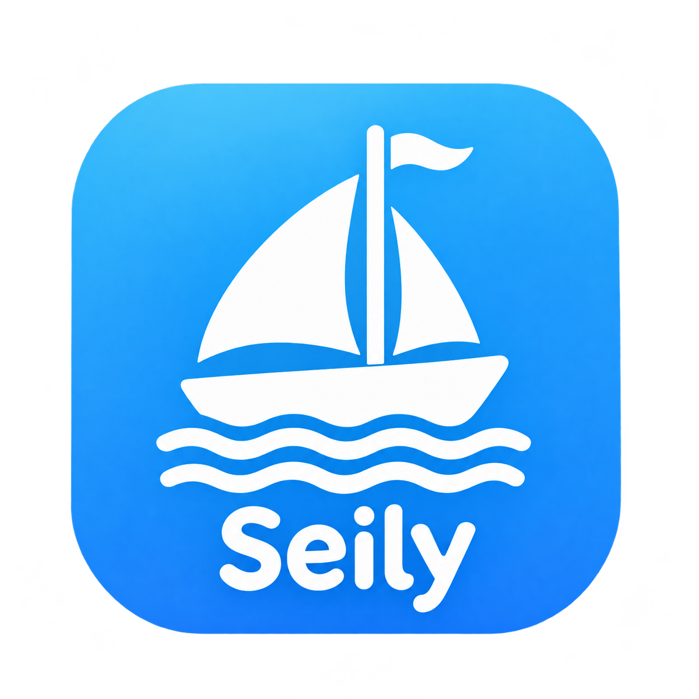

# Seily

Seily is a Linux launcher for the Android version of Roblox, based on [Mocktail](https://github.com/komaruworld/mocktail). It includes performance presets, a setup window, and automatic updates for the official Mocktail runtime.

## Install Seily

Seily currently supports **x86-64 Linux**. You need Git, Python 3, PyGObject, GTK 4, and working AppImage/FUSE support.

On Fedora:

```bash
sudo dnf install git python3 python3-gobject gtk4 fuse-libs
```

On Arch Linux:

```bash
sudo pacman -S --needed git python python-gobject gtk4 fuse2
```

For AppImages, ensure FUSE is working on your system.

Clone this repository and install the app launcher:

```bash
git clone https://github.com/ash262049-png/seily.git
cd seily
bash seily/install.sh
```

Open **Seily** from your application menu to play directly, or **Seily Settings** to change presets and save them. Keep the cloned folder in place, since the launcher runs from it. On first launch, Seily downloads the official Mocktail AppImage; Mocktail downloads the Roblox client separately.

## Settings and updates

Choose an FPS limit, vsync mode, graphics renderer, multithreaded rendering, and an experimental texture-detail override in Seily's setup window. Roblox may ignore the texture override; its in-game Graphics Quality setting also controls visual quality. Performance depends on your hardware and the experience.

Seily checks for official Mocktail runtime updates when you press Play, verifies their published SHA-256 checksum, and keeps the cached runtime if an update fails. **Seily's own launcher and source are not updated automatically.** To update them, run `git pull` inside your Seily clone.

The playable runtime is the upstream Mocktail AppImage, not a separately compiled Seily runtime. The source tree also contains Mocktail's code for development; see [Seily's setup notes](seily/README.md).

## Known limitations

Seily relies on Mocktail, which may fail to start or crash when used with `hardened_malloc`. Run without it enabled. Seily is an independent community project and is not affiliated with Roblox Corporation or the Mocktail project.

## License and credits

Based on [Mocktail](https://github.com/komaruworld/mocktail). Licensed under the [Apache License 2.0](LICENSE); third-party components retain their own licenses.
